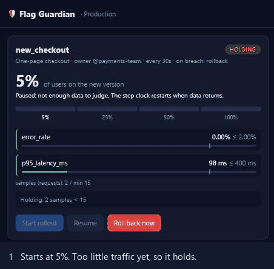
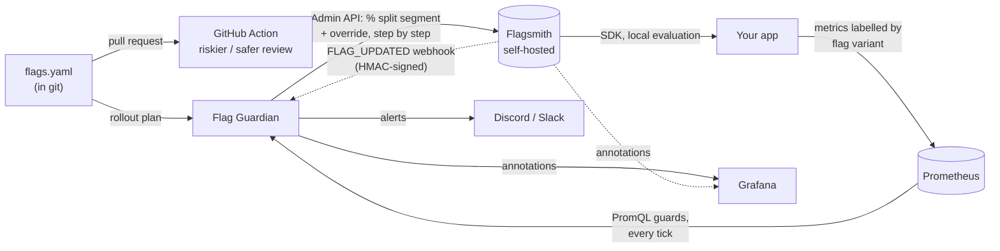
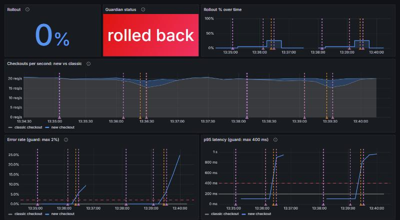

# 🛡️ Flag Guardian

**Health-gated rollouts and automatic rollback for self-hosted [Flagsmith](https://github.com/Flagsmith/flagsmith), with rollout plans stored as code.**

> Flagsmith gives you the switches. Guardian watches them.



Feature flags make releases reversible, but only if someone notices a problem and reacts. Guardian
rolls a flag out step by step (5% → 25% → 50% → 100%), checks your metrics at every step, and turns
the flag off by itself within seconds when something breaks. The rollout plan lives in
`flags.yaml`, next to the code it protects, and every change to it is reviewed in pull requests.

Built for the WeMakeDevs × Flagsmith hackathon, Track 03: *Build on Open Source Flagsmith*.

## How it works



1. **Start**: Guardian creates a `% Split` segment `guardian/<flag>` in Flagsmith and turns the
   flag on for that segment only, at the first step (5%).
2. **Check**: every tick it runs the guard queries from `flags.yaml` against Prometheus, looking
   only at users who got the new version (`flag_new_checkout="on"`), so a bug that hits 5% of
   users is not hidden in the overall numbers.
3. **Advance**: healthy for the whole interval → next step. Flagsmith hashes user IDs, so raising
   the split only adds users; nobody flips back and forth.
4. **Roll back**: a guard fails on two checks in a row → Guardian removes its override, turns the
   flag's default off and alerts. Every user it rolled out to is back on the old version once the
   app's SDK refreshes, within seconds.
5. **Hold** when it can't see: no metric data or too little traffic means no decision either way.
6. **Watch humans**: a manual change in Flagsmith stops the automation (humans win) and starts
   a watch window in which the guards still apply.

## Quickstart

Requires **Docker** with Compose v2 (Docker Desktop, or Docker Engine with the compose plugin on
Linux). Everything runs locally; every port binds to `127.0.0.1`.

**1. Start Flagsmith, Prometheus and Grafana**

```bash
cp .env.example .env
docker compose up -d
```

**2. Set up Flagsmith** at http://localhost:8000

- **Get Started**: create the first admin account and an organisation (the integrations
  question after that can be skipped), then a project named **`demo-shop`**. Flagsmith gives
  it *Development* and *Production* environments.
- **Organisation Settings → API Access → Create API Key** → `FLAGSMITH_API_KEY` in `.env`.
  Guardian uses it to manage segments and overrides.
- Switch the environment to **Production**, then **SDK Keys → Create Server-side Environment
  Key** → `FLAGSMITH_ENVIRONMENT_KEY` in `.env`. Only the demo shop gets this one.

**3. Start Guardian, the demo shop and a load generator**

```bash
docker compose --profile app up -d --build
```

Guardian creates the `new_checkout` feature and its split segment on start. The load generator
sends about 20 checkouts per second from 200 simulated users.

**4. Roll out** at http://localhost:8787 → **Start rollout**, and watch it climb 5% → 25% → 50% → 100%.
On a fresh install the first step holds for about half a minute: nobody has used the new
checkout yet, so there is no data to judge, and Guardian waits rather than guess.

**5. Break it.** Start again, and once it reaches 25%, plant a bug in the new checkout
(15% errors, +600 ms):

```bash
curl -X POST "http://localhost:3001/admin/bug?on=true"     # bash / macOS / Linux
```
```powershell
Invoke-RestMethod -Method Post "http://localhost:3001/admin/bug?on=true"   # Windows PowerShell
```

Guardian flags the breach on the next check, confirms it on the one after, and rolls back. Turn
the bug off again with `on=false`.

| | URL |
|---|---|
| Guardian UI | http://localhost:8787 |
| Grafana dashboard | http://localhost:3000/d/flag-guardian-rollout |
| Flagsmith | http://localhost:8000 |
| Demo shop | http://localhost:3001 |
| Prometheus | http://localhost:9090 |

The CLI runs inside the container too: `docker compose exec guardian node dist/cli.js status`
(also `start new_checkout`, `rollback new_checkout`, `resume new_checkout`, `validate`, `plan`,
`apply`, `diff`).

**Optional:** `DISCORD_WEBHOOK_URL` / `SLACK_WEBHOOK_URL` for alerts, `GRAFANA_TOKEN` for
annotations (see below), `GUARDIAN_API_TOKEN` to require a token for start/rollback.

## `flags.yaml`

```yaml
version: 1
flagsmith: { project: demo-shop, environment: Production }
notify: { discord: ${DISCORD_WEBHOOK_URL} }      # ${VAR} comes from the environment; unset = off

metrics:
  error_rate:
    source: prometheus
    query: |
      (sum(rate(http_requests_total{app="demo-shop",flag_new_checkout="on",status=~"5.."}[30s])) or vector(0))
      / (sum(rate(http_requests_total{app="demo-shop",flag_new_checkout="on"}[30s])) > 0)
  requests:
    source: prometheus
    query: sum(increase(http_requests_total{app="demo-shop",flag_new_checkout="on"}[30s]))

flags:
  new_checkout:
    description: One-page checkout
    owner: "@payments-team"
    expires: 2027-01-31
    rollout: { steps: [5, 25, 50, 100], interval: 30s, samples: requests, min_samples: 15 }
    guards:
      - { metric: error_rate, max: 0.02 }   # the repo's flags.yaml also guards p95 latency
    on_breach: rollback
    watch_manual_changes: 5m
```

| Field | Meaning |
|---|---|
| `flagsmith.project`, `.environment` | Where the flags live (by name). A flag can override `environment`. |
| `notify.discord`, `.slack` | Incoming-webhook URLs for alerts. Empty or unset = no alerts. |
| `metrics.<name>` | `source: prometheus` + `query` (one number), or `source: http` + `url` + `path` (dot path into a JSON response, e.g. `data.error_rate`; a number or numeric string). A query that returns nothing, or NaN/Inf, counts as **no data**, and Guardian holds. |
| `flags.<name>`, `metrics.<name>` | Letters, digits, `_`, `-`, `.`, starting with a letter or digit. |
| `rollout.steps` | Whole percentages, strictly increasing, 1–100. A last step below 100 is allowed (with a warning). |
| `rollout.interval` | How long a step must stay healthy before the next one (`30s`, `5m`, `1h`; also `ms`). Time spent holding does not count. |
| `rollout.samples`, `min_samples` | A metric counting requests in the new cohort. Below `min_samples` (default 0 = off; needs `samples`), Guardian holds: too little traffic to judge either way. |
| `guards[]` | `metric` with `max` and/or `min`. Every guard must pass. |
| `on_breach` | `rollback` (default: flag's default off, Guardian's override removed) or `hold` (stay at the current step and alert). |
| `watch_manual_changes` | How long to keep checking guards after someone changes the flag by hand (default `10m`). |
| `expires`, `owner`, `description` | Bookkeeping. `guardian validate` warns once a flag is past `expires`. |

Your own app needs one thing: request metrics **labelled by flag variant**, like the demo shop's
`flag_new_checkout="on"|"off"`.

## Grafana dashboard



Provisioned from [`infra/grafana/provisioning/dashboards`](infra/grafana/provisioning/dashboards),
so it appears on first start: rollout % and Guardian's status, traffic by variant, and error rate
and p95 per variant with the guard limits as dashed lines. Markers show Guardian's decisions
(orange, tag `guardian`) and Flagsmith's own flag changes (purple, tag `flagsmith`).

For Guardian's markers, create a Grafana service account (role Editor) and a token, and set
`GRAFANA_TOKEN` in `.env`. Flagsmith's markers come from its Grafana integration, which needs
the tunnel below.

## Review rollout changes in pull requests (GitHub Action)

Every pull request that touches `flags.yaml` gets a comment saying what the change does to
each rollout, and the check fails if the file is invalid:

> **Valid** · 1 guarded flag · **2 riskier changes**
>
> | Setting | Before | After | |
> |---|---|---|---|
> | Steps | `5%, 25%, 50%, 100%` | `50%, 100%` | **riskier** |
> | Guard `error_rate` max | `0.02` | `0.2` | **riskier** |

```yaml
# .github/workflows/flags-review.yml
on:
  pull_request:
    paths: [flags.yaml]
permissions:
  contents: read
  pull-requests: write
jobs:
  review:
    runs-on: ubuntu-latest
    steps:
      - uses: actions/checkout@11d5960a326750d5838078e36cf38b85af677262 # v4.4.0
        with: { persist-credentials: false }
      - uses: Niranjan5601/flag-guardian@<commit>   # pin to a full commit SHA
        with:
          config: flags.yaml
          fail-on-riskier: false   # true + branch protection = riskier changes need an override
```

It is **offline**: it compares the PR's `flags.yaml` with the base branch's and never contacts
Flagsmith, so it needs no Flagsmith keys. `${VAR}` references are read as unset (empty), so
secrets in `flags.yaml` never reach the comment. Use it with `on: pull_request` and the default
`actions/checkout` (the PR's merge commit), which is what the base-branch comparison assumes.
Do not use `pull_request_target`.

**Riskier** means more users sooner (a higher percentage at some step), a looser or removed
guard, a shorter interval, fewer required samples, or `hold` instead of `rollback`. A changed
metric query is marked for review, because it changes what "healthy" means.

The same review runs locally (`--base -` reads the old version from stdin; `--fail-on-riskier`
makes it exit 2 on a riskier change, an invalid file exits 1):

```bash
cd packages/guardian
git show main:flags.yaml | npx tsx src/cli.ts diff --base -
```

| Input | Default | |
|---|---|---|
| `config` | `flags.yaml` | path from the repository root |
| `comment` | `true` | post one comment and update it on each push (the review is always in the job summary) |
| `strict` | `false` | warnings (expired flag, last step below 100%) fail the check |
| `fail-on-riskier` | `false` | riskier changes fail the check |

## Connecting Flagsmith's webhook and Grafana integration (optional tunnel)

Flagsmith rejects webhook and integration URLs that resolve to private addresses
(*"URLs must not target internal or private network addresses"*). That is SSRF protection, and
it is a good default, but it means a single-machine install cannot point Flagsmith at
`http://guardian:8787` or `http://grafana:3000`. Without the tunnel, Guardian still catches
manual changes made **during** a rollout (it checks Flagsmith on every tick); the webhook adds
instant notice of changes at any time.

The optional `tunnel` profile solves this without exposing either app:

```
Flagsmith ──HTTPS──▶ ngrok (public URL) ──▶ gateway (nginx) ──┬─ POST /webhooks/flagsmith ─▶ Guardian
                                                              ├─ POST /api/annotations   ─▶ Grafana
                                                              └─ anything else           ─▶ 404
```

1. Create an ngrok account and put its authtoken in `.env` as `NGROK_AUTHTOKEN`
   (the free plan's single static domain is enough: one tunnel serves both paths).
2. Set `FLAGSMITH_WEBHOOK_SECRET` (and ideally `GUARDIAN_API_TOKEN`) in `.env`.
3. `docker compose --profile app --profile tunnel up -d`, then find the public URL with
   `docker compose --profile tunnel logs ngrok` (the line with `url=https://…`) or on your
   ngrok dashboard under Domains. ngrok's local inspector on port 4040 is disabled on purpose
   (no authentication, see `infra/ngrok/ngrok.yml`).
4. In Flagsmith, in the **same environment** Guardian guards (e.g. Production):
   - Environment Settings → Webhooks: `https://<public-url>/webhooks/flagsmith` with the same secret.
   - Project → Integrations → Grafana: Base URL `https://<public-url>`, API key = a Grafana
     service-account token (role Editor).
5. Toggle a guarded flag in Flagsmith: Guardian logs a manual change and starts watching the
   guards; both markers appear on the dashboard.

Stop the tunnel when you are not using it: `docker compose --profile tunnel stop ngrok gateway`.

## How Flagsmith is used

- **Self-hosted** Flagsmith via Docker Compose.
- **Admin API** to create the feature and a `% Split` segment, add and remove a segment
  override (keeping any other overrides your team set), and move the rollout percentage.
- **Environment webhooks** (`FLAG_UPDATED`, HMAC-verified) to notice manual changes.
- **Grafana integration**: Flagsmith's own flag-change annotations sit next to Guardian's.
- **Node SDK** (`@flagsmith/nodejs`) in the demo app, with local evaluation refreshed every 3 s.

**Compared with Flagsmith's Feature Health and Release Pipelines:** Release Pipelines (staged
rollouts) is in closed beta, and both react to "unhealthy" signals you configure in an alerting
tool. Guardian works on any self-hosted Flagsmith today, checks metric thresholds itself at each
percentage step, and keeps the plan in git. It builds on Flagsmith's API and webhooks rather
than replacing anything.

## Security model

The compose file is a **local demo**: Postgres/Django/Grafana use well-known default secrets, so
every published port binds to `127.0.0.1` (`BIND_ADDRESS`). Before exposing anything, read the
header of `docker-compose.yml`.

- **Control API** (`POST /api/flags/<flag>/start|resume|rollback`, used by the UI and CLI):
  - `GUARDIAN_API_TOKEN` set → requires `Authorization: Bearer <token>`. The CLI reads it from
    `.env`; the UI prompts once per tab and keeps it in `sessionStorage`.
  - not set (zero-config demo) → requests must be addressed to `localhost`, and browsers only
    from Guardian's own page. That stops other websites (CSRF) and DNS-rebinding pages, but it
    is a header check: it does **not** stop a non-browser client that can reach the port. What
    keeps other machines out is the listen address: `guardian run` binds `127.0.0.1` by default
    (`--host` / `GUARDIAN_HOST`). In Docker Compose Guardian listens on `0.0.0.0` inside its
    container and the published port is `127.0.0.1` only, so your LAN can't reach it, but
    **other containers on the compose network can call the control API without a token**.
    Set `GUARDIAN_API_TOKEN` for anything beyond a laptop demo.
  - Read-only endpoints (`/api/state`, `/api/stream`, `/metrics`) are open: they show the
    `flags.yaml` plans and metric values, nothing secret.
- **Webhooks**: with `FLAGSMITH_WEBHOOK_SECRET` set, `X-Flagsmith-Signature` (HMAC-SHA256 of the
  raw body) is required. Without it Guardian warns at startup and only refuses browser-originated
  posts and posts through the tunnel gateway, so set the secret anywhere but your laptop.
- **Tunnel** (profile `tunnel`, off by default): the public URL reaches an nginx gateway that
  forwards only `POST /webhooks/flagsmith` and `POST /api/annotations`, always to exactly that
  upstream path (encoded tricks like `%2F..` cannot reach another route). Other paths get 404,
  other methods 403. Guardian's UI and control API and Grafana's UI are not reachable through it.
  Webhooks through the gateway need a valid signature: Guardian refuses unsigned ones there even
  if `FLAGSMITH_WEBHOOK_SECRET` is unset. Annotations need `Authorization: Bearer <token>`; the
  gateway rejects Basic auth and drops cookies, so the Grafana admin password cannot be tried
  from the internet. ngrok's local inspector/API is turned off. Flagsmith includes the changing
  user's email in webhooks and annotations, so it shows up in Guardian's events, chat alerts
  and Grafana tags.
- **Demo shop**: only gets the SDK key. Its planted-bug switch `POST /admin/bug` is off unless
  `DEMO_ADMIN=true` (compose sets it for the demo) and refuses cross-site requests.
- **Containers**: Guardian, demo shop and load generator run as the unprivileged `node` user
  (ngrok runs as `ngrok`; the nginx gateway's master process is root, its workers are not). If
  you created the `guardian-data` volume with an older image (root-owned), fix it once:
  `docker compose run --rm --no-deps --user root --entrypoint chown guardian -R node:node /data`
- **Config is trusted**: `flags.yaml` chooses the Prometheus/HTTP metric URLs and chat webhooks
  Guardian calls, so it should be reviewed like code (that is the point of flags as code, and of
  the GitHub Action).

## Known limitations

- **Manual changes outside a rollout** (flag idle, complete or rolled back) are only noticed
  through the webhook, which on a single machine needs the tunnel. Changes made while Guardian
  is stopped are not reported.
- **Split drift**: every tick Guardian checks that its override is still there and on, and that
  the default is still off. It does not check the percentage inside its segment: a hand edit
  there goes unnoticed (segment edits send no flag webhook) and is overwritten at the next step.
- **Rollback only undoes Guardian's change**: it removes Guardian's override and turns the
  default off. Other segment overrides and identity overrides that turn the flag on are left as
  they are, on purpose, so those users keep the new version.
- **Fixed thresholds**: guards compare against limits, not against the old version's baseline.
- **One Guardian per `flags.yaml`**: no leader election, so don't run two against the same flags.
- **`events.jsonl` grows** without rotation (about 200 bytes per event).
- **Units in the UI** (`%`, `ms`) are guessed from metric names, for display only.
- **zod 3** has an advisory (GHSA-mrhx-c7xc-m3w5, memory use on hostile input); the fix is a
  breaking upgrade to zod 4. zod only parses `flags.yaml`, which is trusted.

## Project layout

```
flags.yaml                  rollout plans (the "as code" part)
action.yml                  GitHub Action: offline PR review of flags.yaml
packages/guardian/          Guardian: controller, Flagsmith client, CLI, HTTP API, UI (TypeScript)
examples/demo-shop/         Express shop using the Flagsmith Node SDK, with a planted-bug switch
examples/loadgen/           steady traffic from simulated users
infra/                      Prometheus scrape config, Grafana provisioning, nginx gateway, ngrok
docker-compose.yml          the whole stack; profiles "app" and "tunnel"
```

Tests: `cd packages/guardian && npm ci && npm test`.

## License

[MIT](LICENSE)
